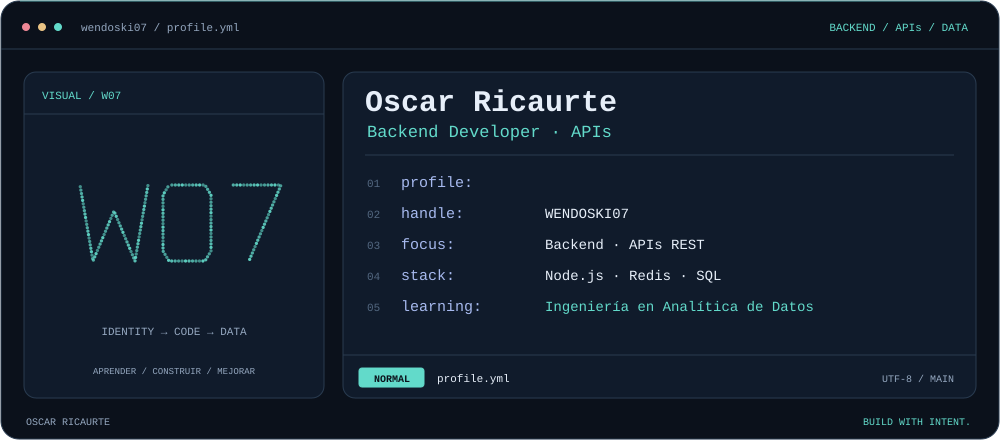
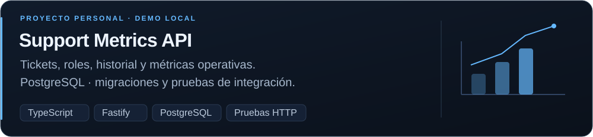
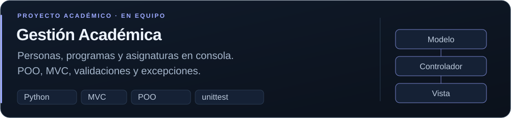
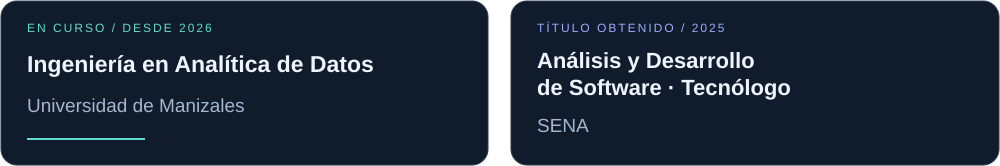

  

  <a href="#proyectos">Proyectos públicos</a> &nbsp; / &nbsp;
  <a href="#experiencia">Experiencia</a> &nbsp; / &nbsp;
  <a href="#stack">Tecnologías</a> &nbsp; / &nbsp;
  <a href="#contacto">Contacto</a>

## Sobre mí

Soy **Oscar Ricaurte**, desarrollador backend. Desarrollo **APIs e integraciones con Node.js, TypeScript y SQL** para aplicaciones web y plataformas de mensajería. Mi experiencia incluye bases de datos relacionales, procesamiento de tareas con Redis y BullMQ, y despliegues con Docker en Linux.

Estudio **Ingeniería en Analítica de Datos** en la Universidad de Manizales. Me interesa conectar el desarrollo backend con la trazabilidad de procesos y el análisis de información.

## Proyectos públicos

  

**[Support Metrics API](https://github.com/WENDOSKI07/support-metrics-api)** es mi proyecto personal de portafolio: una mesa de soporte para registrar solicitudes, conservar su historial y analizar su atención.

<strong>Ver funcionalidades y evidencia técnica</strong>

- TypeScript, Fastify y PostgreSQL, con interfaz web nativa.
- Autenticación mediante sesiones y roles de solicitante y soporte.
- Tickets con comentarios, prioridades, responsables e historial de cambios.
- Control de versiones para detectar actualizaciones en conflicto.
- Métricas operativas, exportación CSV e instantáneas para análisis con Power BI.
- Migraciones SQL, Docker Compose y pruebas aisladas y de integración.

El repositorio incluye instrucciones, reglas del sistema y una guía de rutas. Su alcance es una aplicación local de aprendizaje y demostración. Las comprobaciones documentadas son `npm test` y `npm run test:db`; GitHub Actions está desactivado.

  

**[Sistema de Gestión Académica](https://github.com/WENDOSKI07/sistema-gestion-academica)** es un proyecto académico colaborativo de Programación I de la Universidad de Manizales.

<strong>Ver alcance y colaboración</strong>

Organiza estudiantes, docentes, administrativos, programas y asignaturas mediante una interfaz de consola y arquitectura MVC. Aplica encapsulamiento, herencia, polimorfismo, validaciones y excepciones personalizadas.

Incluye pruebas automatizadas de búsquedas y excepciones. Los datos se mantienen en memoria durante la ejecución. La autoría es compartida; el historial Git identifica los aportes de cada integrante.

## Experiencia en proyectos privados

- **Axiona · Desarrollo backend** — Contribuciones en una plataforma de mensajería con WhatsApp: APIs, integraciones, campañas, procesamiento de respuestas y manejo de archivos multimedia. Node.js, Redis, BullMQ, SQL y Docker en Linux.
- **GIT Colombia · Desarrollo de software en equipo** — Participación en una aplicación de gestión administrativa, talento humano y servicio técnico, con trabajo en backend e interfaz.
- **VC Soft · Prácticas de desarrollo de software** — Apoyo en revisión de pruebas de código, proyectos técnicos y evaluación de perfiles junior.

El código de los proyectos privados no se publica. Las descripciones presentan el contexto de mi participación.

## Tecnologías

| Área | Herramientas |
| --- | --- |
| Backend | JavaScript · TypeScript · Node.js · Fastify · Express |
| Datos y procesamiento | PostgreSQL · MariaDB/MySQL · Redis · BullMQ |
| Entorno y herramientas | Git · Docker · Linux |
| Experiencia complementaria | Python · Java · React |

## Formación

  

<strong>Antecedentes y otros repositorios</strong>

[ProyectoGit-](https://github.com/WENDOSKI07/ProyectoGit-) es el prototipo inicial de GIT Colombia en HTML, CSS y JavaScript. Lo conservo como antecedente del trabajo en equipo.

[Consultar todos mis repositorios](https://github.com/WENDOSKI07?tab=repositories).

## Contacto

[LinkedIn](https://www.linkedin.com/in/oscar-ricaurte-142315367/) · [Repositorios](https://github.com/WENDOSKI07?tab=repositories)
